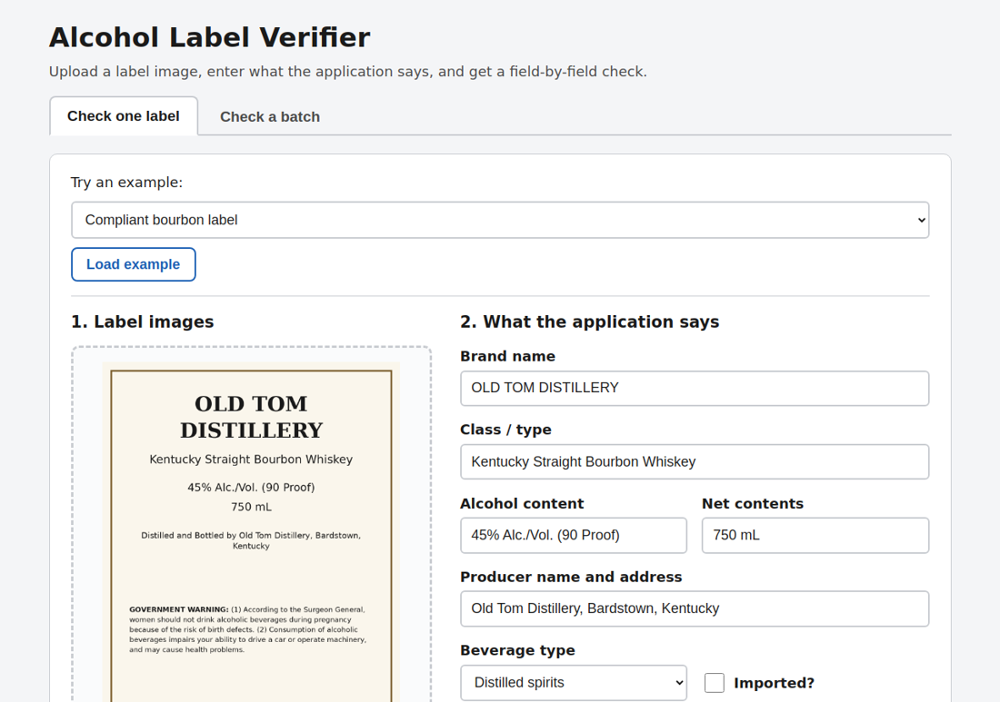
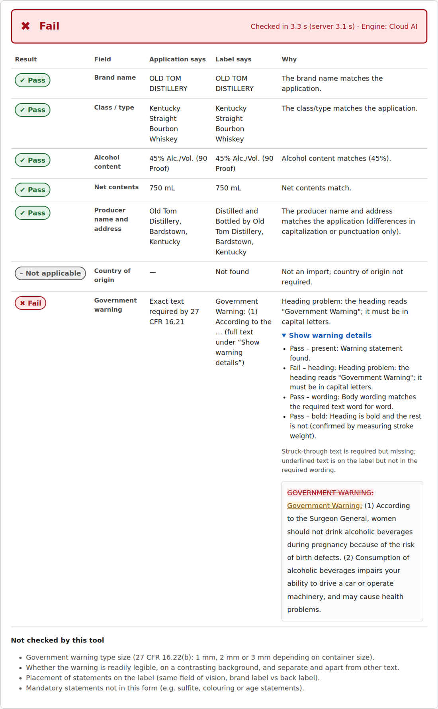
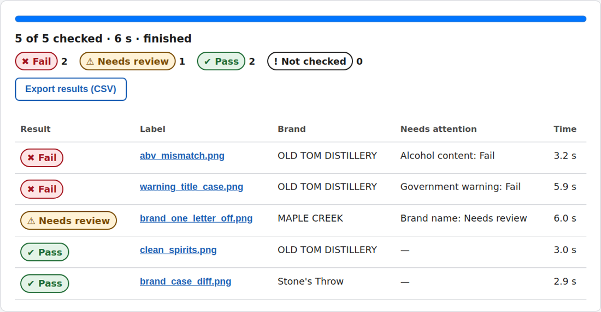
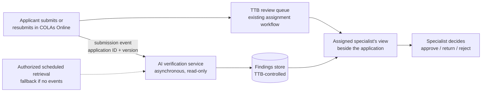

# Alcohol Label Verifier

Checks alcohol beverage label images against the data in the label application: brand, class/type, alcohol content, net contents, producer name and address, country of origin, and the government health warning. For each field it returns **Pass**, **Needs review** or **Fail**, with what the application says, what the label says, the rule applied and the reason. Batch mode checks hundreds of labels from a spreadsheet.

**Live demo (no login): https://ttb-label-verifier.salmonsky-e6ff55c6.eastus2.azurecontainerapps.io**



## Try it in 30 seconds

1. Open the demo. Under **Try an example**, keep "Compliant bourbon label" and click **Load example**, then **Verify label**. Every field passes, including the warning's bold heading.
2. Pick **Warning heading not in capitals** and verify: the warning fails, and **Show warning details** shows the word-level difference.
3. Pick **Brand spelled differently (MAPLE CREAK)**: the brand is **Needs review**, with `CREEK → CREAK` shown.
4. Open **Check a batch** and click **Load a sample batch (5 labels)**, then **Check all labels**. Click a label name to see its full result. **Export results (CSV)** downloads the table.

On a phone, **Take a photo** opens the rear camera.

| Result with a warning violation | Batch results, problems first |
|---|---|
|  |  |

## Evaluation criteria: evidence

| Criterion | Evidence |
|---|---|
| Correctness and completeness | Every field in the brief is checked ([rules](#how-verification-works)). Measured on the deployed app, [validation report](docs/validation-report.md), including **authentic TTB-approved label artwork from the Public COLA Registry**: **0 overall false passes** and 0 field-level misses with either engine over 353 labeled checks; cloud engine false fails 0 on the synthetic sets and 2 of 31 on authentic artwork (one label). 403 automated tests (`tests/`). |
| Code quality and organization | `app/core` is a pure, typed library (pydantic models, no web code): readers behind one `LabelExtractor` interface, rules in `app/core/rules` and `warning.py`, every threshold in `config.py`. `app/api` is a thin FastAPI layer. |
| Appropriate technical choices | One container, no database, no build step: [design decisions](#design-decisions-and-trade-offs). The cloud model costs about $0.0012 per label (measured) and has a hard daily cap. |
| User experience and error handling | One page, two tabs, one-click examples and sample batch. Plain-English errors (wrong file type, too large, unreadable, busy, rate limited). Color always paired with an icon and a word. Works on phones: the result table stacks into cards and the camera opens. Checked in a real browser (Chromium) at desktop and iPhone sizes. |
| Attention to requirements | [Requirement-to-feature map](#requirements-map) below: 5-second target, exact warning, judgment on cosmetic differences, batch of 200 to 300, imperfect photos, nothing stored, works behind a firewall. |
| Creative problem-solving | **The AI reads, rules decide.** The model never sees the application, so it can't be biased toward the expected answer. **Two readers** (cloud vision and offline OCR) cross-check the warning, catching a model that "corrects" altered text. **Bold type is measured from the pixels** as well as asked of the model. **Needs review** for anything unverified. Front and back labels are merged. The batch runs in the browser, so the server stays stateless. |

## Requirements map

| Stakeholder ask | How it is met | Evidence |
|---|---|---|
| Field-by-field comparison | 7 fields, each with expected, found, rule and reason | `app/core/rules`, `tests/unit` |
| Warning word for word, "GOVERNMENT WARNING:" in capitals and bold | Exact comparison with a word diff (a body in all capitals is accepted). Heading capitals and colon. Bold from the model **and** a pixel measurement, which must agree | `app/core/warning.py`, `app/core/stroke.py` |
| About 5 seconds per label | Cloud, measured on the release build: 4.0 s typical (p50) on flat labels, 4.7 s on simulated photos, 5.7 s on authentic artwork; the slowest 5% (p95) took 6.0 to 8.8 s. **The target is met for typical labels, not for the slowest.** Offline: 1.1 to 1.8 s typical. The time is shown on every result | [Measured performance](#measured-performance) |
| Usable without training, many users over 50 | 18 px base font, large buttons, one-click examples, plain-English reasons, colors always with an icon and a word | Screenshots; browser test |
| Judgment on cosmetic differences | `STONE'S THROW` = `Stone's Throw` (Pass). A one-letter difference is **Needs review** with the letters shown, never an automatic Pass | `tests/unit/test_text_fields.py` |
| Batch of 200 to 300 labels | CSV template, checked for problems before starting, 6 at a time, live progress, problems first, retry, CSV export | 300-label run below |
| Imperfect photos | EXIF rotation, deskew, contrast. Blur, glare and darkness are reported. Hard-to-read photos are Needs review, never Fail | 31 simulated photos and 21 authentic registry labels in the validation report |
| Nothing sensitive stored | No database; nothing written to disk except the web framework's temporary buffer for large uploads; no request logs | [Data handling](#data-handling) |
| Works where cloud AI is blocked | Offline OCR engine (Tesseract) in the same container | `EXTRACTOR=local` |

## How verification works

The engine **reads** each image with a reader and then **decides** with deterministic rules. Readers never see the application data.

| Field | Rule |
|---|---|
| Brand name | Exact match ignoring capitalization, punctuation and spacing. A spelling difference, even one letter, is Needs review with the differing words shown |
| Class/type, producer | Every expected word present (ignoring capitalization and punctuation). "Distilled and Bottled by …", "Brewed and Canned by …" and similar prefixes are allowed. A near-miss spelling is Needs review. Class/type lines are also re-read close up by the offline reader; a one-letter variant ("BOUBON") holds a Pass for review |
| Alcohol content | Numeric ABV comparison; any proof on the label must equal 2 × ABV. A label stating several strengths (a keg collar shared by products) is Needs review |
| Net contents | Converted to mL (mL, cL, L, fl oz, pints, quarts, gallons), within 0.5% |
| Country of origin | Imports only: "Product of …", "Made in …", "Imported from …". A statement in another language ("Hecho en …") or a native country name ("ITALIA") is Needs review |
| Government warning | Exact wording (27 CFR 16.21), case-sensitive, except that a body printed entirely in capitals is compared in capitals (16.22 sets the case of the heading only, and most approved labels print the body in capitals); "GOVERNMENT WARNING:" in capitals with the colon; heading bold, body not bold (27 CFR 16.22) |

**Safeguards against false passes**

- **Similar is not the same.** Fuzzy similarity only decides between Needs review and Fail. It never produces a Pass.
- **No Pass from a stray hit.** Text found on the label confirms a field only on its own line, outside the warning, and not on a line already used by another field. Numbers count only next to their unit (`%`, `Proof`, `mL`, …).
- **Two readers for the warning.** With the cloud engine, offline OCR reads the same image in parallel. If the offline reader doubts the wording the model read as exact, the result is Needs review. A simulated model that always returns the textbook warning and formatting never gets a violating label to Pass (`tests/test_fixtures_vision_sim.py`, `tests/test_photo_fixtures.py`).
- **Bold is measured, not just asked.** The stroke thickness of "GOVERNMENT WARNING:" is compared with the body words on the same printed line: a bold heading over regular text measures about 1.7×, the same weight about 1.0×. A bold Pass **or Fail** needs the model's judgment **and** the measurement to agree. Live testing showed why: the model called a regular-weight heading bold 1 time in 5, and called an all-bold warning "heading bold, body regular"; on approved registry labels it called regular capitals "bold" and bold headings "not bold". The measurement counts only when the offline OCR read that warning's words confidently and on one printed line (a sideways warning or a misread one gives no measurement). On small print in photos the measurement often can't confirm bold, so those warnings are Needs review: unverified never means Pass.
- **Readers "correct" misspellings.** On an approved label both readers read "BOUBON" as "BOURBON". The offline reader re-reads short class/type lines close up from unenhanced pixels (it stays blind to the application); a word one letter away from the application's holds the Pass for review.
- **Front and back labels.** Up to 4 images per label are read in parallel and merged. Unless the reviewer ticks **These images show every side of the label**, anything not found is Needs review ("it may be on the back label"), not Fail. A statement that is present but wrong is Fail either way.

**Safeguards against false fails**

- **Reading noise is not a violation.** Differences only in punctuation, only in spacing (`ofthe`), in a few letters the reader was unsure of, or anywhere when the offline reader's confidence over the warning is low, are Needs review with the reason. Confident readings of changed, added or missing words are Fail.
- **Text the model marks illegible** (glare, blur) is Needs review, not a wording difference.
- **Real labels print the warning body in capitals**, sometimes with "WARNING :" spacing or a statement such as "CONTAINS SULFITES" directly below: capitals are accepted, spacing is normalized, and trailing text is Needs review.
- **Unreadable images are never Failed:** they are Needs review with "Request a better image".

## Engines

| Engine | Setting | What it does |
|---|---|---|
| Cloud AI | `EXTRACTOR=auto` (default) | Azure OpenAI gpt-4.1-mini (vision), structured JSON output, temperature 0, 12 s timeout, told to transcribe and never correct (long marketing paragraphs are abbreviated). Offline OCR runs alongside as the cross-check and the fallback: if the cloud is slow, unavailable, rate-limited or over its daily cap, the offline result is used and the reviewer is told. |
| Offline OCR | `EXTRACTOR=local` | Tesseract 5 in the same container. Nothing leaves the server. It can't see bold type, so a label that passes everything else is Needs review for the warning. |

## Measured performance

All numbers are **measured** on the deployed app (Azure Container Apps, 1 vCPU / 2 GiB per replica, 1 to 2 replicas, East US 2), from a client outside Azure, so they include the internet round trip. Release build `982d541`, 2026-10-13, single-image labels.

| | Cloud AI | Offline OCR |
|---|---|---|
| Single label, p50 / p95 round trip: flat labels | 4.0 s / 7.4 s | 1.1 s / 1.4 s |
| Simulated photos | 4.7 s / 5.8 s | 1.6 s / 2.4 s |
| Authentic registry artwork (more text per label) | 5.7 s / 8.0 s | 1.6 s / 2.2 s |
| 300-label batch through the UI (cloud engine, 6 at a time; build `e27a76a`) | **6 min 52 s** (44 labels/min), 0 errors, 299 of 300 read by the cloud engine, 0 false passes, 0 false fails | n/a |
| Cost per label (list price, measured tokens) | about $0.0012 on the synthetic sets, $0.0018 on authentic artwork (≈2,500 input + ≈370 output tokens) | none beyond hosting |

- The first request after the app has scaled to zero waited **33 s** for a cold start (measured with min replicas 0). The review deployment keeps one replica warm.
- The batch ran on one replica. Each replica checks 3 labels at a time and paces cloud calls at 46 per minute, so about 45 labels per minute is that replica's ceiling. A second replica would roughly double throughput; with the platform's default scaling rule it starts only at 10 concurrent requests, and the batch sends 6.
- Latency varies with Azure: an earlier build (`720b52a`) measured 3.5 s / 4.6 s on the synthetic sets in the morning; on the release build in the afternoon the Azure model call alone took 3.7–4.7 s on a simple label, and 3 of 178 cloud requests hit the 12 s timeout (in normal use they fall back to offline OCR). The offline cross-check runs in parallel (about 0.85 s) and does not add to the time. A front + back pair takes about 0.5 s longer (both images are read in parallel).

## Validation summary

[Full report with every label](docs/validation-report.md). Run with `scripts/run_accuracy.py` on the release build `982d541`, 2 repetitions per engine. Three sets, with expected results written by hand, never taken from the app:

- `clean`: 24 synthetic flat rendered labels.
- `photos`: 31 **simulated** photographs (curvature, angle, glare, blur, small print, unusual fonts, front/back pairs). Not real photos.
- `registry`: **authentic** TTB-approved label artwork for 21 records from the [Public COLA Registry](https://ttbonline.gov/colasonline/publicSearchColasBasic.do), 34 cases: as filed, front panel only, and untouched artwork with one application field deliberately wrong. On five approved labels the artwork appears to differ from the rules (warning typos, a misspelled class statement, a missing comma). These are **potential findings that need independent confirmation**, not determinations; they are scored only as "must not Pass".

| Engine | Set | Labels | Overall false pass | False fail | Detection (Fail) | Flagged (not Pass) | Needs review | p50 / p95 round trip |
|---|---|---|---|---|---|---|---|---|
| Cloud AI | clean | 47 | 0/27 | 0/20 | 19/23 (83%) | 23/23 | 8/43 (19%) | 4.0 s / 7.4 s |
| Cloud AI | photos (simulated) | 61 | 0/36 | 0/25 | 27/32 (84%) | 32/32 | 30/57 (53%) | 4.7 s / 6.0 s |
| Cloud AI | **registry (authentic)** | 67 | **0/36** | 2/31 (6%) | 16/24 (67%) | 24/24 | **37/55 (67%)** | 5.7 s / 8.8 s |
| Offline OCR | clean | 48 | 0/28 | 0/20 | 18/24 (75%) | 24/24 | 26/44 (59%) | 1.1 s / 1.4 s |
| Offline OCR | photos (simulated) | 62 | 0/36 | 2/26 | 24/32 (75%) | 32/32 | 32/58 (55%) | 1.7 s / 2.6 s |
| Offline OCR | registry (authentic) | 68 | 0/36 | 16/32 (50%) | 16/24 (67%) | 24/24 | 24/56 (43%) | 1.8 s / 3.4 s |

- **Overall false pass** counts violations, and labels whose right answer is Needs review, that came back Pass overall: **none, on any set, with either engine.** **Needs review** is out of labels whose right answer is Pass or Fail. Three cloud requests timed out and are excluded.
- **Field-level misses are counted separately:** a field that must not pass but did, on a label that was still Needs review or Fail overall. **None on the release build.** Before it, both readers read Woodson's "BOUBON" as "BOURBON" and its class/type passed (4 of 4 runs); a close-up re-read now holds it for review ([details](docs/validation-report.md#overall-false-passes-and-field-level-misses)).
- **No compliant authentic label passed outright.** Cloud engine: 0 Pass, 29 Needs review, 2 Fail out of 31 compliant authentic checks (94% Needs review). Bold can't be confirmed on real print, and real producer statements carry more than the application value (street, ZIP, "for …"), which is shown for review. The tool narrows each label to the fields to look at, with reasons; it does not clear authentic labels on its own.
- **Authentic artwork changed the rules.** The first registry run, on the build before this work, failed 12 of 16 compliant approved labels (warnings printed in capitals, the model's wrong bold judgments, spacing, pints and gallons, keg collars, foreign country statements). Each cause was fixed with tests, without relaxing any false-pass safeguard. The 2 remaining cloud false fails are one keg collar whose brewer name is only inside a logo.
- **The two-reader safeguard worked on real artwork:** the cloud model silently read Cave City's "yovur" as "your"; the offline reader saw the difference, so the label is Needs review, not Pass.
- **Gates (cloud engine):** overall false pass 0% met on every set; false fail 0% met on the synthetic sets, 6% on authentic artwork; Needs review ≤ 20% met only on flat synthetic labels (19%); detection as Fail 67–84%, below the 90% target, with every violation not failed flagged Needs review.

Key thresholds (all in `app/core/config.py`):
- brand: exact words to pass, similarity 85 or more is Needs review;
- warning: 3 or fewer letter edits on words the reader was unsure of, or average OCR confidence under 86%, is Needs review;
- bold: heading/body stroke ratio of 1.4 or more confirms bold, 1.15 or less means the same weight;
- unreadable below 55% reader confidence.

## Regulatory coverage

The prototype compares a label with its application and checks the health warning. It does not decide whether a label meets every labeling regulation. "Checked" means the comparison below; "not checked" items still need a specialist.

| Area | Checked by the prototype | Not checked |
|---|---|---|
| Brand name (all) | Matches the application (capitalization and punctuation ignored; spelling differences go to review) | Whether the name is misleading; placement on the brand label |
| Class/type (all) | Matches the application's class/type wording; a close-up re-read guards against misspellings being "corrected" | Whether the designation meets its standard of identity (e.g. what qualifies as "straight bourbon"); TTB's class/type code |
| Alcohol content (all) | Numeric match with the application; proof equals 2 × ABV; several strengths on one label go to review | Legal tolerances, mandatory vs optional statements (wine at 14% or less, malt beverages), required wording and format |
| Net contents (all) | Numeric match in metric or U.S. units, within 0.5% | Authorized standards of fill; which unit system is required for the product |
| Name and address (all) | Matches the application; "Bottled by", "Imported by" and similar phrases allowed | Whether the phrase fits the operation performed; importer statement rules |
| Country of origin (imports) | Present and matching; foreign-language statements go to review | Customs marking rules beyond the statement itself |
| Health warning (all; 27 CFR part 16) | Exact wording; "GOVERNMENT WARNING:" in capitals with the colon; heading bold and body not bold (reviewed by a person unless confirmed) | Minimum type size, characters per inch, contrasting background, "separate and apart" placement |
| Distilled spirits (27 CFR part 5) | The fields above | Age statements, state of distillation, commodity statements ("distilled from grain"), coloring and flavoring disclosures, neutral-spirits percentages, same-field-of-vision rules |
| Wine (27 CFR part 4) | The fields above | Appellation of origin, varietal and vintage-date rules, estate bottled, the sulfite declaration, alcohol tolerances, semi-generic names |
| Malt beverages (27 CFR part 7) | The fields above, including pints and gallons | Alcohol-content rules specific to malt beverages, "low/non-alcoholic" terms, flavor-derived alcohol, products under FDA rather than TTB labeling rules |
| All products | | Other mandatory disclosures (e.g. FD&C Yellow No. 5, cochineal/carmine, aspartame), claims and statements (health, organic), formula approval, label size and legibility, state requirements |

## Future COLAs Online Integration — Not Implemented

This section is a proposal only: there is no connector, no queue and no storage in this prototype.



- **Runs beside the existing queue.** A submission event (preferred) or an authorized scheduled retrieval (fallback) starts verification asynchronously. The queue, the assignment rules and the specialist's decision authority do not change; the AI never approves or rejects.
- **Exact version tracking.** Every result is keyed by the application ID and the exact submission version (resubmissions and corrections included), so a finding never appears against artwork it was not run on.
- **Three separate statuses.** TTB application status (owned by COLAs Online), AI processing status (queued, running, done, failed; "failed" means the specialist reviews as today), and the AI assessment (Pass / Needs review / Fail per field, with reasons).
- **Findings stored automatically** in a future TTB-controlled system, visible to the assigned specialist in their view of the application, and kept under TTB's records rules.
- **Deployment.** Proposed: an agency-approved government cloud (e.g. Azure Government) with private connectivity to COLAs Online and no public endpoint, subject to service availability in that cloud (including the vision model) and to security authorization. The offline engine covers any part of the workflow where cloud AI is not approved.

## Design decisions and trade-offs

- **AI reads, rules decide.** A vision model is far better than OCR on curved, glossy, decorative labels, but it can be confidently wrong and it knows what a warning "should" say. So it only transcribes, blind to the application, and deterministic, tested rules make every decision.
- **Needs review over guessing.** A wrong Pass is the costly error for a compliance reviewer. Anything unverified (bold type the pixels can't confirm, a one-letter brand difference, a missing back label) goes to a person with the reason. The cost is a higher review rate on poor photos.
- **Local and cloud engines.** The offline engine covers networks that block cloud AI and is the automatic fallback. It is also the independent second reader in cloud mode.
- **The batch runs in the browser.** The browser sends 6 requests at a time to the same single-label API. The server holds no job state, so it scales across replicas and survives restarts, and progress is live with no polling infrastructure.
- **No database, no storage.** Nothing to secure, back up or purge; results live in the reviewer's browser and their CSV export.
- **Stack:** Python 3.12, FastAPI, Tesseract, OpenCV, rapidfuzz; plain HTML/JS/CSS (no build step); one Docker image built with `az acr build`.

## Usage protection (server side)

The public demo has no login, so spending is limited in the server; budget alerts only notify.
- **Uploads:** 10 MB per image, up to 4 images per label, enforced while the request streams in. JPEG, PNG and WebP only. The browser converts phone HEIC photos and very large images to JPEG where it can.
- **Rate limit:** 120 checks per minute per IP. Only the address added by the platform's own proxy is trusted.
- **Daily cloud cap:** 1,000 cloud calls per replica (2 replicas maximum). Past the cap, the app uses offline OCR and says so.
- **Cloud pacing** keeps calls within the model quota, calibrated from Azure's own count (about 1,300 tokens per label): 46 per minute per replica. A single check over the pace uses offline OCR at once; batch requests wait up to 45 s for a cloud slot. After a 429, the app waits as long as Azure asks.
- **Concurrency:** at most 3 checks at a time per replica; others wait up to 30 s, then get "server is busy". The batch client retries those automatically.

## Data handling

The app keeps nothing after a request: no database, no files, and label content is never logged.
- Uploads over 1 MB are briefly buffered to a temporary file by the web framework, deleted when the request ends.
- **Cloud engine:** each image is sent to Azure OpenAI (regional Standard deployment, East US 2). Microsoft states that prompts and completions are not used to train or improve models and are not stored in the model. By default, Azure OpenAI abuse monitoring may store prompts and completions flagged as potentially abusive, in the resource's geography, for review by authorized Microsoft employees. Customers approved for modified abuse monitoring can turn that off. Sources, checked 2026-10-13: [Data, privacy, and security](https://learn.microsoft.com/en-us/azure/ai-foundry/responsible-ai/openai/data-privacy); [Abuse monitoring](https://learn.microsoft.com/en-us/azure/ai-foundry/openai/concepts/abuse-monitoring). This deployment uses the default.
- **Logs:** the Container Apps environment has no log destination, so application and request logs are not retained. API responses include the model's token counts for cost tracking.

## Production considerations

- **Hosting:** the same container runs in Azure Government, or on a customer-hosted server with `EXTRACTOR=local` and no outbound calls.
- **Data retention:** for sensitive submissions, apply for modified abuse monitoring, or use the offline engine.
- **Access:** sign-in would be Microsoft Entra ID in front of the app (Container Apps built-in authentication); the per-IP limits would become per-user.
- **Audit trail:** if needed, results could be written to an approved records system instead of only exported to CSV.

## Limitations and assumptions

- **Authentic artwork, not photographs.** The registry set is real approved label artwork (flat files as submitted to TTB); the photo set is simulated. Phone photographs of real bottles have not been measured.
- **On authentic artwork nearly everything is Needs review** with the cloud engine (67%; no compliant label passed outright), mainly bold confirmation and producer statements with extra words. Overall false passes were 0; false fails 2 of 31 (one keg collar, brewer name only in a logo). A lower review rate would need a reliable bold signal on real print, which neither the model nor the stroke measurement gives.
- **Readers can correct misspellings** ("BOUBON" read as "BOURBON" by both readers). The warning has a second reader as a cross-check, and class/type lines get an offline close-up re-read (tuned on one real example; no false alarms on the 75 other labels). Brand and producer have neither.
- **Offline OCR on authentic artwork** fails half of the compliant labels (decorative fonts, sideways and light-on-dark text). It never passed a violation. Use the cloud engine where allowed.
- **Bold on small print in photos is often Needs review.** At about 13 px text height, regular and bold condensed type measure nearly the same. Our synthetic renders confirm bold reliably (bold headings measure about 1.7×); approved registry artwork did not (bold headings measured 0.96–1.36×), so authentic labels are usually Needs review for bold.
- **Needs review rate on photos is high** (about half of the simulated photos with the cloud engine). That's the cost of the bold and two-reader safeguards. On flat synthetic labels it is within the 20% gate.
- **Offline OCR on photos** misreads small and curved print. Low-confidence readings are Needs review rather than Fail, but a word lost under glare can still cause a Fail.
- **Not checked:** see [Regulatory coverage](#regulatory-coverage) for what the prototype does and does not check for spirits, wine and malt beverages.
- **Not attempted:** perspective correction of strongly angled photos, and live video scanning.

## Run locally

Requires Python 3.12 and Tesseract 5 (`sudo apt-get install -y tesseract-ocr` on Debian/Ubuntu).

```bash
python3.12 -m venv .venv
.venv/bin/pip install -e ".[dev]"
EXTRACTOR=local .venv/bin/uvicorn app.api.main:app --port 8710
```

Open http://127.0.0.1:8710 and load an example. For the cloud engine, set `AZURE_OPENAI_ENDPOINT` and `AZURE_OPENAI_DEPLOYMENT`, and sign in with `az login` (or set `AZURE_OPENAI_API_KEY` for local development). See `.env.example`.

- **Tests:** `.venv/bin/python -m pytest` (about 4 minutes). The `ocr`-marked tests run real Tesseract on every fixture; skip them with `-m "not ocr"`.
- **Fixtures:** `python scripts/make_fixtures.py` and `python scripts/make_photo_fixtures.py` regenerate them. The authentic registry set (`tests/fixtures/registry`, cases and truth in `scripts/make_registry_fixtures.py`) needs its images downloaded first: `pip install playwright && playwright install chromium && python scripts/fetch_registry_images.py`. The artwork is not committed; `tests/fixtures/registry/SHA256SUMS` confirms the download is byte-identical to what was tested.
- **Accuracy:** `python scripts/run_accuracy.py <url> --set clean --set photos --set registry --provider azure --provider local --report docs/validation-report.md` measures a running instance; `scripts/registry_breakdown.py` adds the per-kind registry table.
- **Docker:** `docker build -t ttb-label-verifier . && docker run -p 8000:8000 -e EXTRACTOR=local ttb-label-verifier` runs the offline engine with no Azure settings. The deployed image is built from this Dockerfile with `az acr build`; the development VPS has no local Docker, so `docker run` itself was not tested there.

## Deployment

The Azure infrastructure was provisioned separately: a resource group, Azure OpenAI with a gpt-4.1-mini Standard deployment, a Basic container registry, Container Apps, and a managed identity with least-privilege roles. The app is deployed onto it with:

```bash
python deploy/azure/app_deploy.py check  -g rg-ttb-label-verifier            # read-only
python deploy/azure/app_deploy.py deploy -g rg-ttb-label-verifier --confirm  # az acr build + containerapp update
```

`check` verifies:
- the model, deployment type and keyless (Entra ID) sign-in;
- the managed identity's roles (Cognitive Services OpenAI User on Azure OpenAI, AcrPull on the registry);
- ingress, container size, replica range and quota.

`deploy` builds the image in the registry and updates the existing app. It clears a placeholder start command if there is one, and sets the cloud pace from the quota. Its smoke test calls only `/api/health` and `/api/config`, never the model. `deploy/azure/deploy.sh` is a reference script for provisioning from scratch.

## Layout

```
app/core/        typed library: models, engine (multi-image merge), rules, warning, stroke (bold), quality, readers
app/api/         FastAPI: /api/verify, /api/health, /api/config, usage protection, plain-English errors
app/web/         one static page (vanilla JS, no build step), CSV template, examples
deploy/azure/    app_deploy.py (app-only deploy onto existing resources), deploy.sh (reference provisioning)
scripts/         fixture generators, run_accuracy.py, OFL fonts used for the photo fixtures
tests/           unit, API, real-OCR fixture tests, simulated-reader tests, photo safety tests
docs/            validation report, screenshots
```

## AI tools used in development

This project was built with Claude Code (Anthropic) as a coding assistant, working from an approved design: it wrote code, tests, fixtures and documentation under review. All verification results above are measured, and every rule is covered by tests. At run time the app uses Azure OpenAI gpt-4.1-mini only to transcribe label images.
